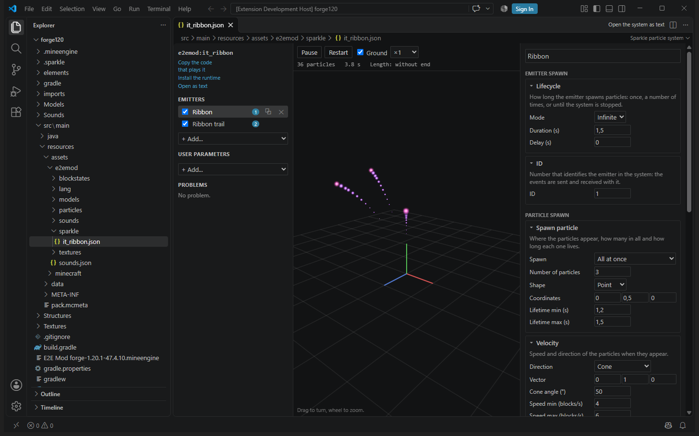

# Sparkle pour VS Code

Le système de particules Sparkle de Mine Engine, sorti en extension VS Code : un éditeur visuel de systèmes de
particules avec des modèles et un aperçu 3D, et un petit **runtime Java** qui les joue en jeu, le même pour
**Forge, NeoForge et Fabric**.

[English version](README.md)



## Ce que fait l'extension

- **Nouveau système de particules** (palette de commandes, ou clic droit sur un dossier) : choisir un modèle
  (Étincelles, Rayon, Fontaine, Rebond, Ruban, Vide) et un nom. Le fichier est créé dans
  `src/main/resources/assets/<mod id>/sparkle/<nom>.json`. Un fichier existant n'est jamais écrasé.
- **Éditeur** : tout fichier `assets/<namespace>/sparkle/*.json` s'ouvre dans l'éditeur Sparkle.
  - À gauche : le nom à donner au code, les émetteurs (ajout depuis un modèle, duplication, suppression, case
    « affiché dans l'aperçu »), les paramètres utilisateur et les problèmes détectés.
  - Au centre : l'aperçu 3D animé (lecture et pause, redémarrage, sol, vitesse). Faire glisser pour tourner, la
    molette pour zoomer. Les textures du projet (`assets/<ns>/textures/particle/*.png`) sont affichées et teintées
    comme en jeu ; une texture du jeu (`minecraft:...`) est montrée comme un point lumineux de la bonne couleur.
  - À droite : les modules de l'émetteur choisi, rangés comme dans Mine Engine (apparition de l'émetteur et des
    particules, mise à jour, rendu, événements). Chaque réglage compatible peut être **lié à un paramètre
    utilisateur**.
  - Chaque modification passe par VS Code : **Ctrl+Z / Ctrl+Y**, l'enregistrement, Git et l'éditeur texte
    fonctionnent comme pour n'importe quel fichier. « Ouvrir en texte » montre le JSON, avec complétion et
    validation par le schéma `schemas/sparkle-system.schema.json`.
- **Installer ou mettre à jour le runtime dans le mod** : détecte le loader, la version de Minecraft, le mod id et
  le package du mod, puis écrit le runtime dans `<package du mod>.sparkle`.
- **Copier le code qui joue le système** : met dans le presse-papiers `Sparkle.play(level, "mymod:fire", x, y, z);`,
  avec ses paramètres utilisateur s'il en a.

Le format des fichiers est celui de Sparkle dans Mine Engine (les fichiers de Mine Engine, avec `properties`, sont
lus aussi). Les champs et modules inconnus sont gardés tels quels à l'enregistrement.

## Jouer un système en jeu

Depuis le serveur (un bloc, un item, une commande, un événement...) :

```java
import com.example.mymod.sparkle.Sparkle;
import com.example.mymod.sparkle.SparkleParameters;

Sparkle.play(level, "fire", x, y, z);                       // "fire" = "<mod id>:fire"
Sparkle.play(level, "mymod:beam", pos);                     // au centre d'un bloc
Sparkle.playOn(entity, "aura");                             // suit l'entité
Sparkle.stopOn(entity);
Sparkle.stopAt(level, x, y, z, 5.0);                        // arrête les systèmes dans un rayon de 5 blocs
Sparkle.play(level, "beam", x, y, z, SparkleParameters.create()
        .vector("end", 0, 1, 8)
        .color("tint", 0xFF8800)
        .number("speed", 4));
```

Côté client, rien à écrire : le système est lu dans les ressources la première fois qu'il joue, et relu après
**F3+T**. On peut donc modifier un système dans VS Code et le revoir en jeu sans relancer Minecraft.

### Comment ça marche, quel que soit le loader

- Un seul type de particule est enregistré : `<mod id>:sparkle`. Il transporte le nom du système, l'entité suivie,
  l'action (jouer / arrêter) et les valeurs des paramètres. Le serveur l'envoie avec le **paquet de particules du
  jeu** (`ServerLevel.sendParticles`) : aucun code réseau propre à un loader.
- Le client lit `assets/<ns>/sparkle/<nom>.json`, puis joue les émetteurs comme le fait l'aperçu : mêmes règles,
  en ticks au lieu des secondes.
- Les textures viennent de l'atlas des particules : toute image de `assets/<ns>/textures/particle/` y est déjà.
- Enregistrement sans toucher à la classe principale du mod :
  - **Forge** et **NeoForge** : des classes `@EventBusSubscriber` ;
  - **Fabric** : deux points d'entrée ajoutés à `fabric.mod.json`, après confirmation.

### Fichiers installés

| Dossier du runtime | Quand |
| --- | --- |
| `runtime/common` | toujours : API, lecture des systèmes, particules |
| `runtime/mc1.20` | Minecraft 1.20 à 1.20.4 (ancien format réseau des particules) |
| `runtime/mc1.21` | Minecraft 1.20.5 et plus (`MapCodec` et `StreamCodec`) |
| `runtime/mc1.21.9` | Minecraft 1.21.9 et plus : remplace la particule de `common` (`SingleQuadParticle`) |
| `runtime/forge`, `runtime/neoforge`, `runtime/fabric` | le loader du projet |
| `runtime/neoforge-1.21.4` | NeoForge 1.21.4 et plus : remplace les deux classes de `neoforge` |

Un fichier d'un dossier suivant remplace le fichier du même nom d'un dossier précédent. Les noms changés par Mojang ou
par un loader sont remplacés à l'écriture du runtime : `ResourceLocation` devient `Identifier` à partir de 1.21.11,
`getLightColor` devient `getLightCoords` à partir de 26.1, Forge 1.21.6 et plus prend le `SubscribeEvent`
d'EventBus 7, et Fabric API 26.1 et plus son `ParticleProviderRegistry`.

## Versions prises en charge

| Loader | Testé (compilé) | Accepté avec un avertissement | Refusé |
| --- | --- | --- | --- |
| Forge | 1.20.1, toutes les versions de 1.21.1 à 26.3 | les autres 1.20.x, 1.21, après 26.3 | avant 1.20 |
| NeoForge | 1.20.6, toutes les versions de 1.21.1 à 26.3 | 1.20.1 (traité comme Forge), 1.20.5, 1.21, après 26.3 | 1.20.2 à 1.20.4, avant 1.20 |
| Fabric | 1.20.1, 1.20.4, toutes les versions de 1.21.1 à 26.3 | les autres 1.20.x, 1.21, après 26.3 | mappings **Yarn**, avant 1.20 |

« Testé » veut dire : le runtime compile dans un vrai projet Gradle de ce loader et de cette version, créé par
`test-runtime/compile.mjs` avec le plugin Gradle du loader (Fabric Loom, ModDevGradle, ForgeGradle). Minecraft 26.1
et plus n'est plus obfusqué : un projet Fabric n'a pas besoin de mappings.

## Sécurité de l'installation

- Le fichier `.sparkle/runtime.json` garde l'empreinte de chaque fichier écrit.
- Un fichier modifié à la main depuis l'installation, ou un fichier du même nom qui n'a pas été écrit par Sparkle,
  n'est **jamais remplacé sans question** : « Remplacer (copie gardée) » ou « Garder le mien ».
- Les fichiers remplacés ou retirés sont copiés dans `.sparkle/backup/<date>/`.
- Une réinstallation identique n'écrit rien. Les fins de ligne changées par Git ne comptent pas comme une
  modification.
- `fabric.mod.json` n'est modifié qu'après confirmation, en gardant son format et ses commentaires.

## Limites connues

- **Pas encore essayé en jeu.** Le runtime compile sur toutes les versions testées, et l'aperçu suit les mêmes
  règles, mais aucun client Minecraft n'a été lancé, sur aucune version. C'est le prochain test à faire.
- **Fabric avec Yarn** : refusé. Le runtime est écrit avec les noms de Mojang ; il faut
  `mappings loom.officialMojangMappings()` dans `build.gradle`. Fabric API est nécessaire.
- **Projets multi-loader** (Architectury, MultiLoader) : on peut installer dans chaque sous-projet de loader, mais
  pas encore dans le module commun.
- Aperçu :
  - le sol est un plan à y = 0, pas des blocs ;
  - une texture qui n'est pas dans le projet est un point coloré ;
  - une texture animée (`.mcmeta`) montre sa première image.
- Les textes de l'éditeur suivent la langue de VS Code (anglais et français). Le français n'apparaît que si le pack
  de langue français de VS Code est installé.

## Développement

```bash
npm install
npm run build        # dist/extension.js et dist/webview.js
npm run typecheck
npm test             # tests unitaires (Node)
npm run package      # crée le .vsix
```

- Les tests unitaires vérifient aussi que le catalogue TypeScript, le runtime Java et le schéma JSON connaissent
  exactement les mêmes réglages.
- **Test d'intégration** : `npm run build:integration`, puis lancer VS Code avec
  `--extensionDevelopmentPath=<ce dossier> --extensionTestsPath=<ce dossier>/out/integration/index.js` sur la copie
  d'un projet de mod. Le test installe le runtime, puis teste ces cas :
  - réinstallation sans rien changer ;
  - fichier modifié à la main, gardé puis remplacé ;
  - création d'un système depuis un modèle ;
  - refus d'écraser un système existant ;
  - ouverture dans l'éditeur ;
  - copie du code ;
  - annulation (Ctrl+Z).

  Il écrit son résultat dans le fichier donné par `SPARKLE_IT_RESULT`.
- Le catalogue des modules est `src/shared/catalog.ts`. Le runtime lit les mêmes noms dans
  `runtime/common/SparkleEmitter.java`.
