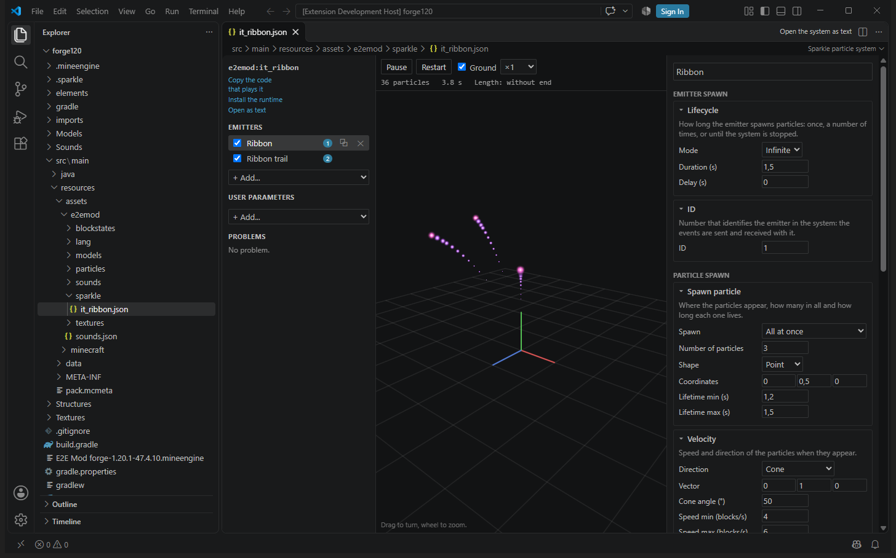

# Sparkle particles for Minecraft mods

A visual editor for particle systems in Minecraft mods, with templates and a live 3D preview, plus a small
**Java runtime** that plays them in the game. The same runtime works on **Forge, NeoForge and Fabric**.

Sparkle comes from the particle editor of Mine Engine.

[Version française](README.fr.md)



## Features

- **New particle system** (Command Palette, or right-click a folder): pick a template (Sparks, Beam, Fountain,
  Bounce, Ribbon, Empty) and a name. The file is created in
  `src/main/resources/assets/<mod id>/sparkle/<name>.json`. An existing file is never overwritten.
- **Visual editor**: every `assets/<namespace>/sparkle/*.json` file opens in the Sparkle editor.
  - Left: the name to use in code, the emitters (add from a template, duplicate, delete, show in the preview),
    the user parameters and the problems found in the system.
  - Center: the animated 3D preview (play and pause, restart, ground, speed). Drag to rotate, scroll to zoom.
    Particle textures of the project (`assets/<ns>/textures/particle/*.png`) are shown and tinted as in the game.
    A vanilla texture (`minecraft:...`) is shown as a glowing dot of the right color.
  - Right: the modules of the selected emitter, grouped as in Mine Engine: emitter spawn, particle spawn,
    particle update, render and events. Each compatible setting can be **bound to a user parameter**, so that
    your code can change it on each play.
  - Every change goes through VS Code, so **Ctrl+Z / Ctrl+Y**, saving, Git and the text editor work as for any
    other file. "Open as text" shows the JSON, with completion and validation from a JSON schema.
- **Install or update the runtime in the mod**: detects the loader, the Minecraft version, the mod id and the
  package of the mod, then writes the runtime into `<mod package>.sparkle`.
- **Copy the code that plays the system**: puts `Sparkle.play(level, "mymod:fire", x, y, z);` on the clipboard,
  with the user parameters of the system, if it has any.

## Playing a system in the game

From the server side (a block, an item, a command, an event...):

```java
import com.example.mymod.sparkle.Sparkle;
import com.example.mymod.sparkle.SparkleParameters;

Sparkle.play(level, "fire", x, y, z);                       // "fire" = "<mod id>:fire"
Sparkle.play(level, "mymod:beam", pos);                     // at the center of a block
Sparkle.playOn(entity, "aura");                             // follows the entity
Sparkle.stopOn(entity);
Sparkle.stopAt(level, x, y, z, 5.0);                        // stops the systems within 5 blocks
Sparkle.play(level, "beam", x, y, z, SparkleParameters.create()
        .vector("end", 0, 1, 8)
        .color("tint", 0xFF8800)
        .number("speed", 4));
```

Nothing to write on the client side. A system is read from the resources the first time it plays, and read
again after **F3+T**. You can edit a system in VS Code and see the change in the game without restarting
Minecraft.

Players install nothing: the runtime is part of your mod.

### How it works on every loader

- One particle type is registered: `<mod id>:sparkle`. It carries the system name, the followed entity, the
  action (play or stop) and the parameter values. The server sends it with the **vanilla particle packet**
  (`ServerLevel.sendParticles`), so there is no loader-specific networking code.
- The client reads `assets/<ns>/sparkle/<name>.json` and plays the emitters with the same rules as the preview,
  in ticks instead of seconds.
- Textures come from the particle atlas: any image in `assets/<ns>/textures/particle/` is already in it.
- Nothing to change in the main class of the mod:
  - **Forge** and **NeoForge**: `@EventBusSubscriber` classes;
  - **Fabric**: two entrypoints added to `fabric.mod.json`, after you confirm.

### Installed files

| Runtime folder | When |
| --- | --- |
| `runtime/common` | always: API, system reader, particles |
| `runtime/mc1.20` | Minecraft 1.20 to 1.20.4 (old particle network format) |
| `runtime/mc1.21` | Minecraft 1.20.5 and later (`MapCodec` and `StreamCodec`) |
| `runtime/mc1.21.9` | Minecraft 1.21.9 and later: replaces the particle of `common` (`SingleQuadParticle`) |
| `runtime/forge`, `runtime/neoforge`, `runtime/fabric` | the loader of the project |
| `runtime/neoforge-1.21.4` | NeoForge 1.21.4 and later: replaces the two classes of `neoforge` |

A file of a later folder replaces the file of the same name of an earlier one. The names that Mojang or a loader
changed are replaced when the runtime is written: `ResourceLocation` becomes `Identifier` from 1.21.11,
`getLightColor` becomes `getLightCoords` from 26.1, Forge 1.21.6 and later takes the `SubscribeEvent` of EventBus 7,
and Fabric API 26.1 and later its `ParticleProviderRegistry`.

## Supported versions

| Loader | Tested (compiled) | Accepted with a warning | Refused |
| --- | --- | --- | --- |
| Forge | 1.20.1, every version from 1.21.1 to 26.3 | other 1.20.x, 1.21, after 26.3 | before 1.20 |
| NeoForge | 1.20.6, every version from 1.21.1 to 26.3 | 1.20.1 (handled as Forge), 1.20.5, 1.21, after 26.3 | 1.20.2 to 1.20.4, before 1.20 |
| Fabric | 1.20.1, 1.20.4, every version from 1.21.1 to 26.3 | other 1.20.x, 1.21, after 26.3 | **Yarn** mappings, before 1.20 |

"Tested" means that the runtime compiles in a real Gradle project of that loader and version, made by
`test-runtime/compile.mjs` with the Gradle plugin of the loader (Fabric Loom, ModDevGradle, ForgeGradle).
Minecraft 26.1 and later is not obfuscated: a Fabric project needs no mappings there.

## Safe installation

- `.sparkle/runtime.json` keeps a hash of every file written by Sparkle.
- A file edited by hand since the install, or a file with the same name not written by Sparkle, is **never
  replaced without asking**: "Replace (keep a copy)" or "Keep mine".
- Replaced or removed files are copied to `.sparkle/backup/<date>/`.
- Reinstalling the same version writes nothing. Line endings changed by Git do not count as an edit.
- `fabric.mod.json` is only changed after you confirm, keeping its formatting and comments.

## Known limitations

- **Not yet played in the game.** The runtime compiles on every tested version and the preview follows the same
  rules, but in-game rendering has not been checked yet, on any version.
- **Fabric with Yarn** is refused. The runtime uses Mojang names: `build.gradle` needs
  `mappings loom.officialMojangMappings()`. Fabric API is required.
- **Multi-loader projects** (Architectury, MultiLoader): the runtime can be installed in each loader subproject,
  not yet in the common module.
- Preview:
  - the ground is a plane at y = 0, not blocks;
  - a texture that is not in the project is shown as a colored dot;
  - an animated texture (`.mcmeta`) shows its first frame.
- The editor is available in English and French; it follows the display language of VS Code.

## Development

```bash
npm install
npm run build        # dist/extension.js and dist/webview.js
npm run typecheck
npm test             # unit tests (Node)
npm run package      # builds the .vsix
```

- The unit tests also check that the TypeScript catalog, the Java runtime and the JSON schema know exactly the
  same settings.
- **Compile test of the runtime**: `node test-runtime/compile.mjs fabric:1.21.4 neoforge:26.3 forge:1.21.8 ...` makes
  a small mod project for each loader and version, installs the runtime as the extension does, and compiles it with
  Gradle. Gradle runs on `JAVA25_HOME` (Java 25 or later) or, for ForgeGradle 6 (Forge 1.21.1 and before), on
  `JAVA21_HOME`. The first build of a version downloads Minecraft and the loader. After a successful run, add the
  versions to `TESTED` in `src/shared/project.ts` (and in the IntelliJ plugin, `ProjectDetection.kt`).
- **Integration test**: run `npm run build:integration`, then start VS Code with
  `--extensionDevelopmentPath=<this folder> --extensionTestsPath=<this folder>/out/integration/index.js` on a copy
  of a mod project. The test installs the runtime, then covers:
  - reinstalling without changes;
  - a file edited by hand, kept then replaced;
  - creating a system from a template;
  - refusing to overwrite an existing system;
  - opening the editor;
  - copying the code;
  - undo (Ctrl+Z).

  It writes its result to the file given by `SPARKLE_IT_RESULT`.
- The module catalog is `src/shared/catalog.ts`. The runtime reads the same names in
  `runtime/common/SparkleEmitter.java`.
